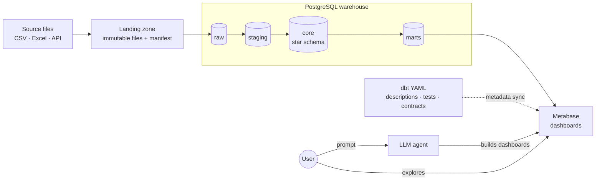

# prompt-to-dashboard

End-to-end data platform: a layered warehouse with governed metadata, and an LLM agent that turns
natural-language requests into dashboards in a self-service BI tool.

> **Status:** early development – repository skeleton and landing zone are in place.
> See the [roadmap](#roadmap).

## What it does

1. Source files are landed unchanged, checksum-verified and versioned per load.
2. dbt builds the warehouse in Postgres: staging → core star schema → documented marts.
3. Metadata written once in dbt (descriptions, grain, glossary, tests) is synced to Metabase.
4. You type a request such as *"monthly net revenue by product category in EUR, 2023 vs 2024"*.
   The agent builds the dashboard in Metabase, where you keep exploring it like any other.

The central idea: **metadata quality is what makes LLM-generated dashboards trustworthy.** The
agent never sees raw tables – only documented marts with declared grain and defined metrics. The
evaluation phase measures how much that documentation actually improves accuracy.

## Architecture



## Tech stack

Everything runs locally and costs nothing.

| Concern | Tool | Status |
|---|---|---|
| Landing | Python, checksum-pinned source registry | ✅ |
| Raw load | dlt | planned |
| Warehouse | PostgreSQL 17 | ✅ container |
| Transformations, tests, docs | dbt-core | planned |
| Orchestration | Dagster | planned |
| BI and semantic metadata | Metabase (open source) | ✅ container |
| LLM | Gemini API free tier or a local model via Ollama | planned |
| CI | GitHub Actions | ✅ lint + landing smoke test |

Decisions and their trade-offs are recorded as [architecture decision records](docs/adr/).

## Data governance principles

- **One source of truth for metadata** – descriptions live in dbt YAML in git and are pushed to
  Metabase, never edited in two places.
- **Everything the agent can see is documented** – every mart and column has a description and
  declared grain; CI fails on undocumented models.
- **Contracts on marts** – breaking schema changes fail the build instead of breaking dashboards.
- **Least privilege** – the BI tool and the agent read marts through a read-only role.
- **Reproducibility** – data is never committed; `git clone` plus a few `make` targets rebuilds
  everything from pinned sources.

## Getting started

Prerequisites: [Docker](https://docs.docker.com/get-docker/), [uv](https://docs.astral.sh/uv/),
`make` and `git`.

```bash
git clone https://github.com/ondrejpelant/prompt-to-dashboard.git
cd prompt-to-dashboard
make setup   # Python deps, git hooks, creates .env from .env.example
make land    # downloads the dataset into data/landing/
make up      # starts Postgres and Metabase on http://localhost:3000
```

Run `make` to list all targets.

## Repository layout

```
├── ingestion/        landing zone script and source registry
├── dbt/              warehouse transformations, tests and documentation
├── orchestration/    Dagster pipeline
├── bi/               Metabase metadata sync and dashboard exports
├── agent/            LLM agent and chat interface
├── eval/             benchmark questions and accuracy results
├── infra/            container init scripts
└── docs/             ADRs and data profiling
```

## Roadmap

- [x] **0 – Scope and dataset** – dataset chosen and profiled ([profiling](docs/data-profiling.md))
- [ ] **0 – Business questions** that drive marts, metrics and the evaluation set
- [x] **1 – Repository skeleton** – structure, containers, CI, conventions
- [x] **2a – Landing zone** – checksum-pinned, immutable, idempotent
- [ ] **2b – Raw load** into Postgres with audit columns and simulated incremental loads
- [ ] **3 – Staging** – typing, naming, deduplication, source tests
- [ ] **4 – Core** – conformed dimensions, facts with declared grain, SCD2
- [ ] **5 – Marts and governance** – contracts, full documentation, business glossary
- [ ] **6 – BI layer** – metadata sync to Metabase, read-only access
- [ ] **7 – LLM agent** – prompt → Metabase dashboard
- [ ] **8 – Evaluation** – accuracy with vs. without metadata, model comparison
- [ ] **9 – Orchestration and operations** – Dagster, freshness checks, docs site

## Data

The project uses the **Contoso V2** synthetic retail dataset (~93k orders, 2016–2025) generated by
[SQLBI's Contoso Data Generator](https://github.com/sql-bi/Contoso-Data-Generator-V2), released
under the MIT license. Why this dataset: [ADR-0001](docs/adr/0001-dataset-contoso-v2.md).

## License

[MIT](LICENSE)
