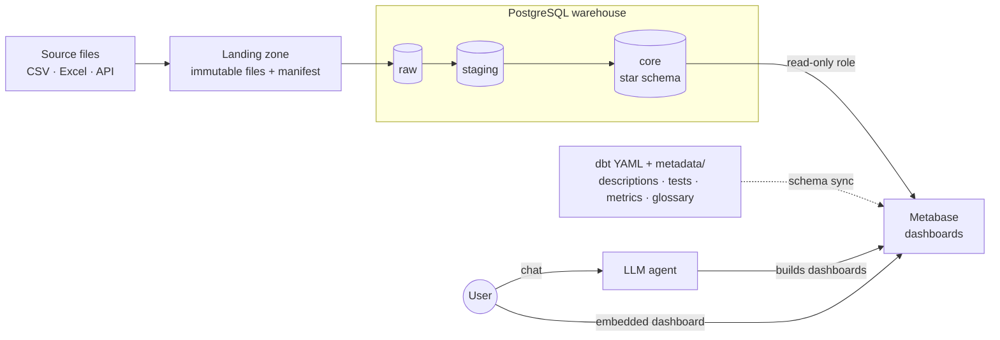

# prompt-to-dashboard

End-to-end data platform: a layered warehouse with governed metadata, and an LLM agent that turns
natural-language requests into dashboards in a self-service BI tool.

> **Status:** the full pipeline and a conversational agent are working end to end, from the
> landing zone to a chat UI; evaluation and orchestration are next. See the [roadmap](#roadmap).

## What it does

1. Source files are landed unchanged, checksum-verified and versioned per load.
2. dbt builds the warehouse in Postgres: staging → a core star schema, documented column by
   column, with metric definitions and a business glossary alongside it.
3. Metabase reads the core schema through a read-only role; it picks up the descriptions and
   the primary/foreign keys from Postgres during its own schema sync.
4. You describe a problem in a chat (`uv run poe app`), such as *"net revenue has been falling
   in recent years – check whether that's true"*. The agent writes and proves the SQL, answers
   in words, and builds a dashboard in Metabase, embedded right next to the chat; a follow-up
   keeps refining the same dashboard.

The central idea: **metadata quality is what makes LLM-generated dashboards trustworthy.** The
agent never sees raw tables – only documented marts with declared grain and defined metrics. The
evaluation phase measures how much that documentation actually improves accuracy.

## Architecture



There is no separate `marts` schema (yet): the agent and Metabase read `core` directly through
the read-only role. ADR-0002 named a `marts` layer for contracts and a stable public surface;
revisit if `core` needs to change in ways that would otherwise break dashboards.

## Tech stack

Everything runs locally and costs nothing.

| Concern | Tool | Status |
|---|---|---|
| Landing | Python, checksum-pinned source registry | ✅ |
| Raw load | psycopg + Postgres `COPY` ([ADR-0003](docs/adr/0003-raw-load-psycopg-copy.md)) | ✅ |
| Warehouse | PostgreSQL 17 | ✅ container |
| Transformations, tests, docs | dbt-core | ✅ staging + core |
| Metrics and glossary | Plain YAML next to dbt (`dbt/metadata/`) | ✅ |
| Orchestration | Dagster | planned |
| BI | Metabase (open source) | ✅ container, read-only role |
| LLM agent | Gemini API ([ADR-0004](docs/adr/0004-custom-agent-with-gemini.md)–[0006](docs/adr/0006-embedded-dashboard-streamlit-ui.md)) | ✅ chat UI, `uv run poe app` |
| Evaluation | 20 questions, reference SQL, with/without metadata | ✅ `uv run poe eval` |
| CI | GitHub Actions | ✅ lint, landing, raw load, dbt build, Metabase sync (no LLM calls) |

Decisions and their trade-offs are recorded as [architecture decision records](docs/adr/).

## Data governance principles

- **One source of truth for metadata** – descriptions live in dbt YAML in git and are pushed to
  Metabase, never edited in two places.
- **Everything the agent can see is documented** – every mart and column has a description and
  declared grain; CI fails on undocumented models.
- **Contracts** – breaking schema changes should fail the build instead of breaking dashboards.
  Not enforced yet; `core` has no dbt contract and no separate `marts` layer sits in front of it.
- **Least privilege** – the BI tool and the agent read `core` through a read-only role
  (`bi_reader`), never `raw` or `staging`.
- **Reproducibility** – data is never committed; `git clone` plus a few `uv run poe` tasks rebuild
  everything from pinned sources.

## Getting started

Prerequisites: [Docker](https://docs.docker.com/get-docker/), [uv](https://docs.astral.sh/uv/)
and `git`. The commands are identical on Windows, macOS and Linux.

```bash
git clone https://github.com/ondrejpelant/prompt-to-dashboard.git
cd prompt-to-dashboard
uv run poe setup    # installs Python and dependencies, creates .env, installs git hooks
uv run poe land     # downloads the dataset into data/landing/
uv run poe up       # starts Postgres and Metabase on http://localhost:3000
uv run poe raw      # loads it into the raw schema
uv run poe build    # builds and tests staging and core with dbt
uv run poe metabase # connects Metabase to the warehouse (needs a Metabase admin API key)
uv run poe app      # opens the chat UI (needs a Gemini API key in .env)
```

Run `uv run poe` to list all tasks. They are defined in [`pyproject.toml`](pyproject.toml).

## Repository layout

```
├── ingestion/        landing zone script and source registry
├── dbt/              warehouse transformations, tests and documentation
├── orchestration/    Dagster pipeline
├── bi/               Metabase metadata sync and dashboard exports
├── agent/            LLM agent and chat interface
├── eval/             benchmark questions and accuracy results
├── infra/            container init scripts
├── tools/            helpers for the developer tasks
└── docs/             ADRs and data profiling
```

## Roadmap

- [x] **0 – Scope and dataset** – dataset chosen and profiled ([profiling](docs/data-profiling.md))
- [x] **1 – Repository skeleton** – structure, containers, CI, conventions
- [x] **2a – Landing zone** – checksum-pinned, immutable, idempotent
- [x] **2b – Raw load** into Postgres with audit columns ([ADR-0003](docs/adr/0003-raw-load-psycopg-copy.md))
- [x] **3 – Staging** – typing, naming, one view per raw table, source tests
- [x] **4 – Core** – conformed dimensions, a fact with declared grain, SCD2 store history
- [x] **5 – Metadata and governance** – full column documentation, metric definitions, a
      business glossary ([dbt/metadata/](dbt/metadata/)); no contracts or `marts` layer yet
- [x] **6 – BI layer** – metadata and key sync to Metabase, read-only access
- [x] **7 – LLM agent** – chat UI, answers in words with a dashboard embedded live
      ([ADR-0004](docs/adr/0004-custom-agent-with-gemini.md)–[0006](docs/adr/0006-embedded-dashboard-streamlit-ui.md))
- [x] **8 – Evaluation** – 20 questions, reference SQL, measured with and without metadata
- [ ] **9 – Orchestration and operations** – Dagster, freshness checks, docs site

## Data

The project uses the **Contoso V2** synthetic retail dataset (~93k orders, 2016–2025) generated by
[SQLBI's Contoso Data Generator](https://github.com/sql-bi/Contoso-Data-Generator-V2), released
under the MIT license. Why this dataset: [ADR-0001](docs/adr/0001-dataset-contoso-v2.md).

## License

[MIT](LICENSE)
