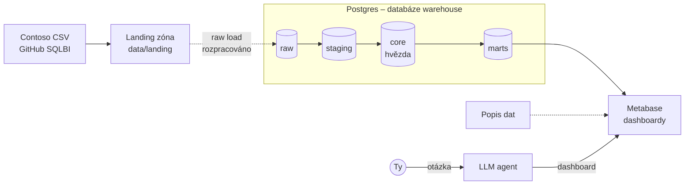

# Architektura

Zpět na [[00 Start]]

## Restaurace na data

| Restaurace | V projektu | Stav |
|---|---|---|
| Dodavatel přiveze zboží | dataset Contoso (CSV z GitHubu SQLBI) | ✅ |
| **Rampa** – krabice neotevřené, zkontrolované, s protokolem | landing zóna `data/landing/` – [[Landing zóna]] | ✅ |
| Nosič z rampy do skladu | raw load – [[Raw load - zadání]] | 🔄 |
| **Sklad s regály** | Postgres, schéma `raw` – [[Docker]] | ✅ budova stojí, prázdná |
| **Kuchyně** – vyčistit, propojit, spočítat | dbt: `staging` → `core` | |
| **Štítky na surovinách** | popis tabulek, sloupců, metrik a pojmů | |
| **Výdejní okénko** | `marts` – hotové tabulky pro agenta | |
| **Jídelna** | Metabase, `localhost:3000` | ✅ běží |
| **Číšník** – vezme objednávku slovy, přinese talíř | LLM agent → dashboard | |

Nestavíme jídelní lístek s pevnými jídly. Stavíme dobře popsanou spíž a kuchaře, který uvaří, co si host objedná.

## Tok dat

## Tři dráhy příkazů

| Dráha | Příkaz | Co se stane |
|---|---|---|
| Data | `uv run poe land` | `land_source.py` stáhne archiv, ověří pečeť, uloží do `data/landing/` |
| Infrastruktura | `uv run poe up` | Docker podle `docker-compose.yml` a `.env` spustí Postgres a Metabase |
| Kvalita | `git commit` → `git push` | pre-commit u tebe, pak CI na GitHubu – [[Kontroly kvality]] |
